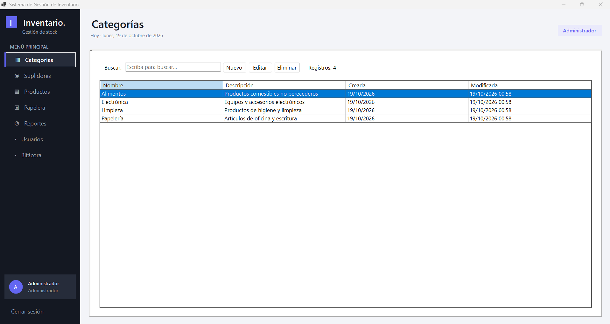
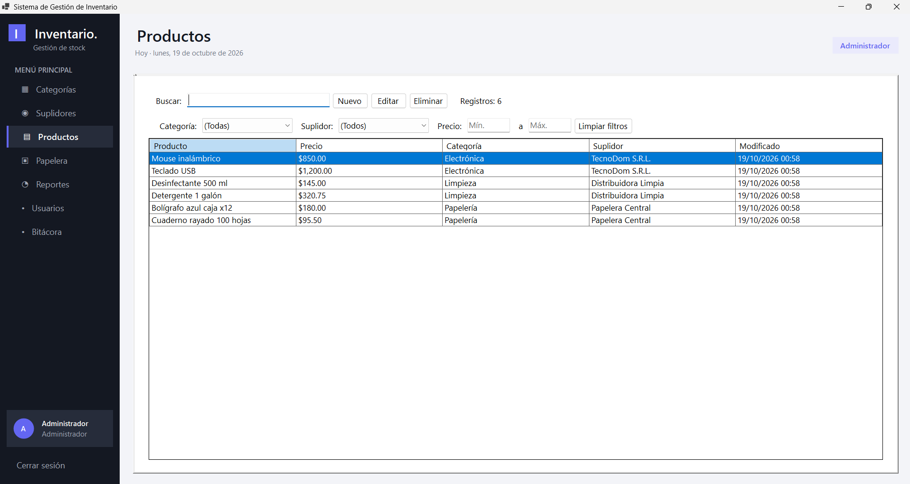
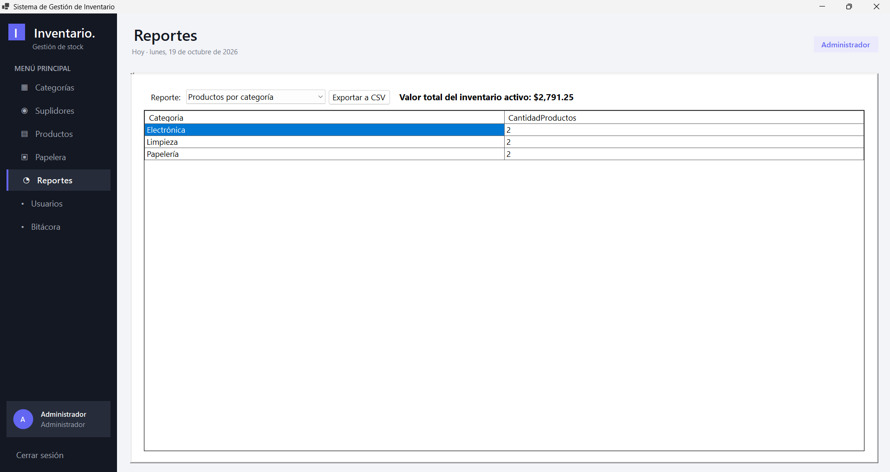
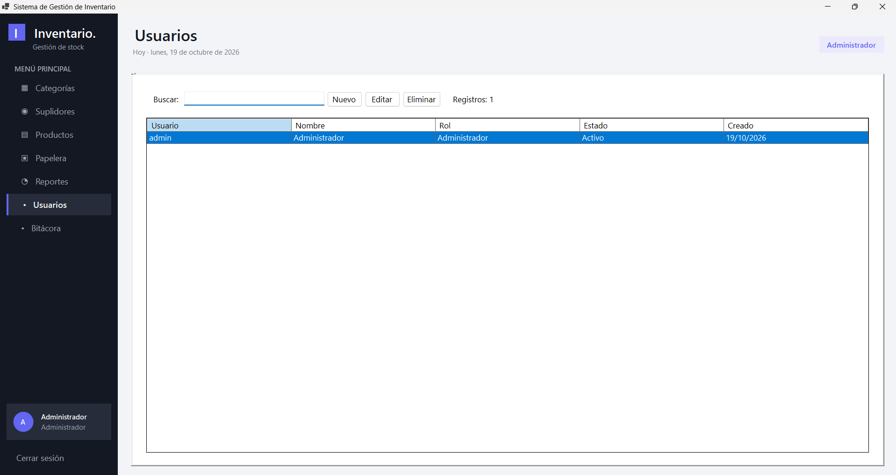
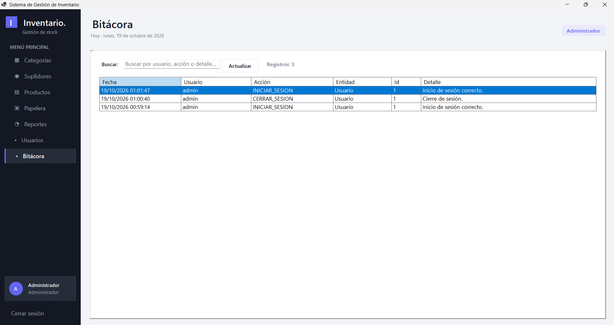

# Capturas de pantalla

## Categorías

Administración de las categorías de productos: alta, edición, desactivación y fotos asociadas.

## Productos

Listado de productos con filtros por texto, categoría, suplidor y rango de precio, y formulario de edición.

## Papelera

Registros desactivados de categorías, suplidores, productos y usuarios, con opción de restaurarlos.

[Papelera de elementos eliminados](capturas/papelera.png)

## Reportes

Resumen del inventario: valor total, productos por categoría, top 5 de suplidores y precio promedio por categoría.

## Usuarios

Gestión de cuentas del sistema y sus roles (Administrador y Operador).

## Bitácora

Historial de acciones realizadas por los usuarios sobre las entidades del sistema.

